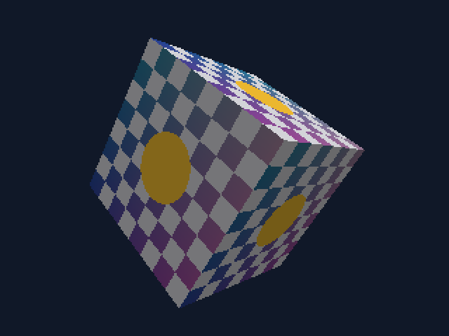

# corrina-gpu

FXG-1: a small GPU with programmable vertex and fragment shaders, written in
Verilog, plus everything needed to drive it from Linux as a PCI Express
device: a QEMU device model that co-simulates the RTL, and a DRM render driver
written in Rust.

The frame above was rendered by the RTL, through the Rust driver, inside a
Linux 7.3 guest. It is bit-identical to what the standalone RTL testbench
produces.

## What is here

| Path | What |
|---|---|
| `rtl/fxg_gpu.v` | The pipeline: DMA loads, clears, vertex fetch, perspective divide, triangle setup, rasteriser, depth test, colour write |
| `rtl/fxg_shader.v` | Shader core: 16 registers, Q16.16, 30 opcodes including branches, texture sampling and reciprocal |
| `rtl/fxg_div.v` | Sequential divider |
| `tools/fxgasm.py` | Assembler for the shader ISA |
| `shaders/` | Demo vertex and fragment programs |
| `sim/` | Verilator harness: standalone testbench and the QEMU bridge |
| `qemu/fxg.c` | QEMU PCIe endpoint (BAR0, bus-master DMA, MSI) that forwards to the bridge |
| `driver/` | Rust DRM driver, laid out as an overlay for a kernel tree |
| `demo/fxg_demo.c` | Userspace client: renders the cube through `/dev/dri/renderD*` |
| `vm/` | Scripts to build an initramfs and boot the whole stack |
| `docs/ROADMAP.md` | What separates this from a Vulkan-capable GPU |

## How the hardware works

A job is a set of registers in BAR0 (`include/fxg_regs.h`). Every buffer it
names lives in host memory and is reached by bus-master DMA: shader programs,
uniforms, vertices, the texture, the colour target and the depth target. The
GPU has no memory of its own beyond a 512-word program RAM and 32 uniforms.

Writing `START` runs: load programs and uniforms, clear, then for each
triangle run the vertex program three times, divide by w, set up edge
functions, and walk the bounding box. Each covered pixel gets barycentric
weights, an early depth test, perspective-correct varyings, a fragment program
run, and a colour and depth write. Completion raises an interrupt.

PCI Express itself (PHY, link, transaction layers) is not in this RTL. On an
FPGA those come from the vendor's hard IP, and in simulation QEMU plays that
role. The core's two buses are plain valid/ready interfaces meant to be
wrapped: `s_*` by AXI4-Lite, `m_*` by an AXI4 master.

## Running it

RTL only (needs Verilator 5 and Python 3):

    cd sim && make tb && ./obj_tb/fxg_tb frame.ppm

Full stack:

1. **QEMU.** Copy `qemu/fxg.c` and `qemu/fxg_proto.h` into `hw/misc/` of a
   QEMU source tree (tested on 8.2.2), append
   `system_ss.add(files('fxg.c'))` to `hw/misc/meson.build`, and build
   `qemu-system-x86_64`.
2. **Kernel.** `driver/install.sh /path/to/linux` (written against 7.3), then
   enable `CONFIG_RUST`, `CONFIG_DRM` and `CONFIG_DRM_FXG` and build. Rust in
   the kernel needs rustc 1.85 or newer and bindgen 0.71.1 or newer.
3. **Bridge and demo.** `make -C sim bridge && make -C demo`
4. **Boot.**

       vm/mkinitrd.sh initrd.gz demo/fxg_demo
       QEMU=.../qemu-system-x86_64 vm/run.sh .../arch/x86/boot/bzImage initrd.gz | tee console.log
       vm/extract-frame.sh console.log frame.ppm

The demo prints an FNV-1a hash of the frame. The testbench prints the same
hash for the same scene, which is how the two paths are compared.

## Driver interface

Four ioctls on the render node (`driver/include/uapi/drm/fxg_drm.h`):
`BO_CREATE`, `BO_WRITE`, `BO_READ`, `SUBMIT`. Buffer objects are
DMA-contiguous because the GPU has no MMU and is handed bus addresses. The
driver checks every size a job implies against the buffer behind it before
touching the hardware; that check is the only memory protection there is.

## Known limits

- Fixed point, not float. Vertices near or behind the eye reject the whole
  triangle because there is no clipper.
- One texture (power-of-two, nearest, repeat), one colour target, no blending,
  no stencil, depth compare is LESS only.
- One shared shader core and one pixel at a time: about 3.2 million clock
  cycles for the 320x240 demo frame.
- `SUBMIT` blocks, and jobs from different clients are serialised by a mutex.
- No buffer mmap: the kernel's Rust GEM abstraction has none for DMA memory.
- The RTL simulates, lints clean and passes generic Yosys synthesis. It has not
  been mapped to a device or timed.
- `owns_edge` in `rtl/fxg_gpu.v` is a stub: shared triangle edges are drawn
  twice. See the TODO there.
